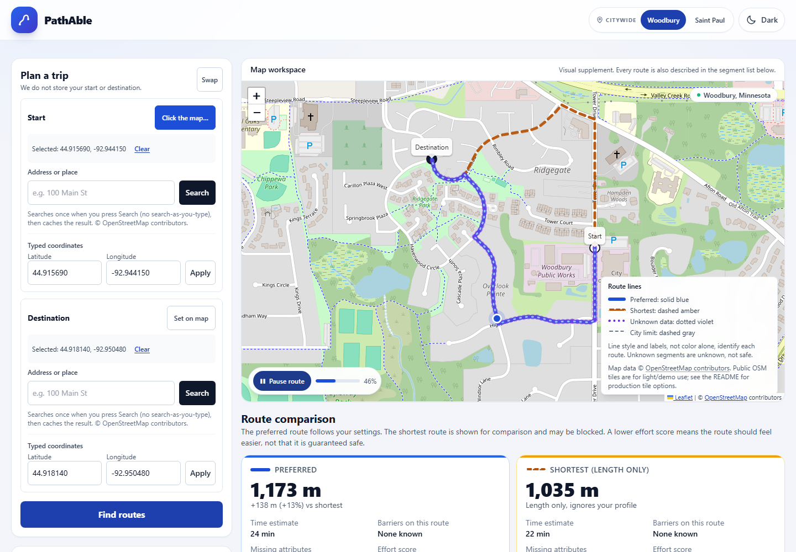
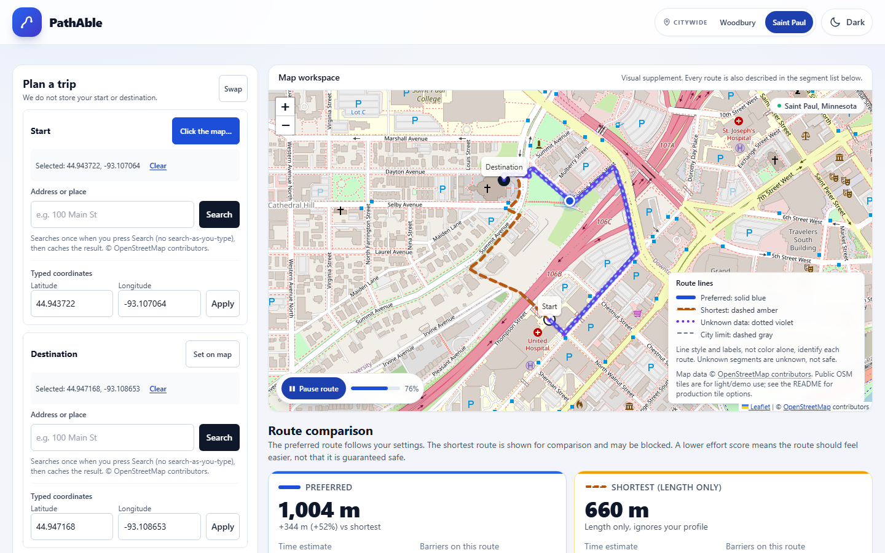
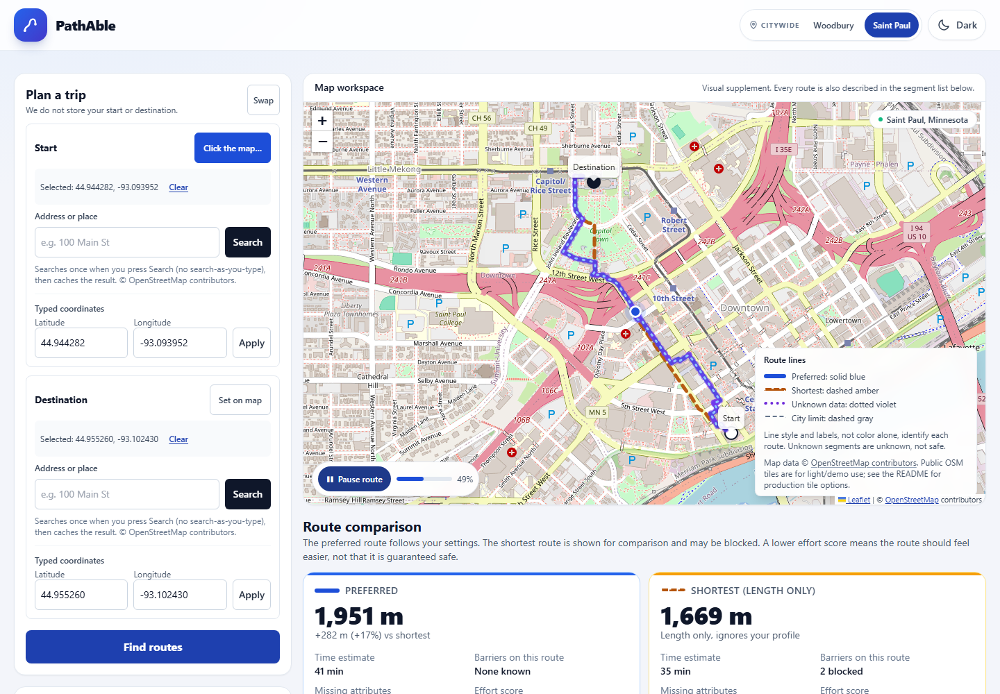
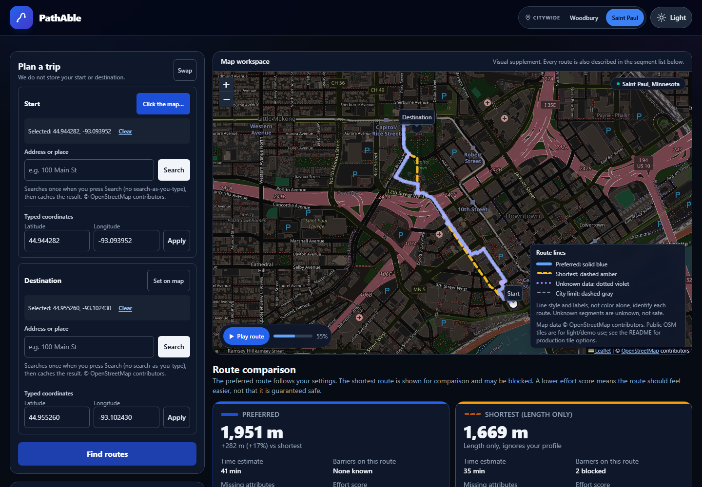
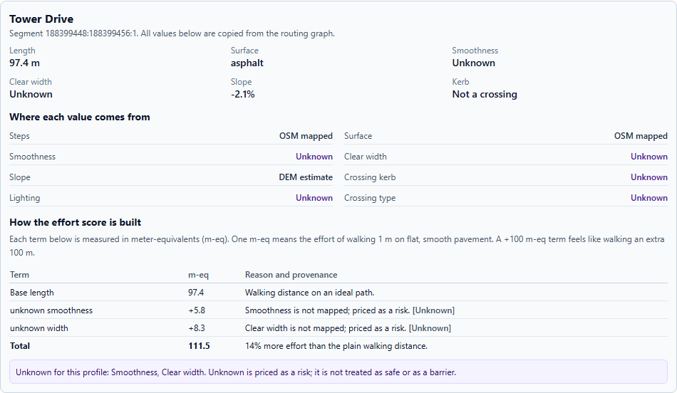
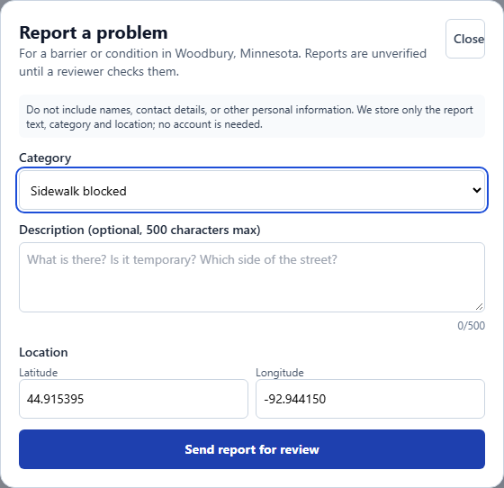
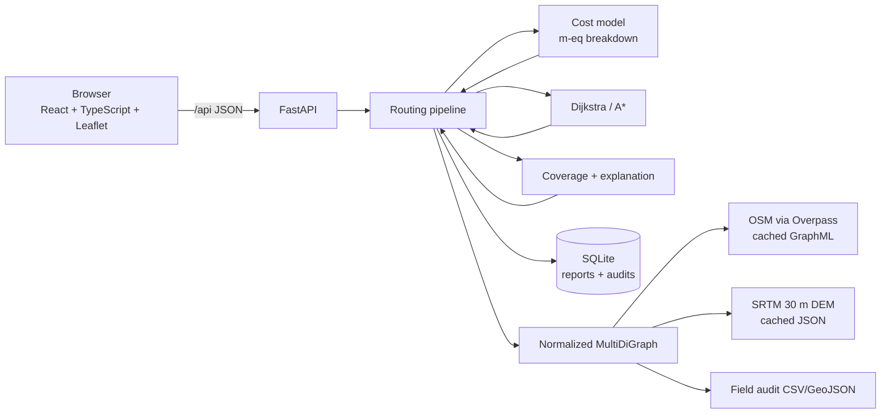

# PathAble

**Pedestrian routes that show their work.**

PathAble is a student project for the Congressional App Challenge. It plans pedestrian
routes for people with mobility needs and is explicit about what the data knows. It does
not say a route "is accessible." It shows what is mapped, what is estimated, what was
reported, and what is still unknown.

Two whole-city mapping areas are included: **Woodbury, Minnesota** and **Saint Paul,
Minnesota**. Each one uses a public landmark as its center and an OpenStreetMap city
boundary as its real limit, so the map covers the whole city instead of a small circle.



The screenshot above uses the committed Woodbury sample extract in demo mode. If the
preferred route takes a detour, the explanation names the slope, surface, crossing, or
barrier cost that caused it. Coverage counts how much of the needed data is mapped. It is
not a safety score, and an unmapped attribute is never treated as safe.

## What it is

- A FastAPI + React web app with a real routing engine, not a mock-up.
- A tunable cost model in **meter-equivalents**: distance, slope, roughness, width,
  crossings, barriers, community reports, and unknown-data risk in one explainable number.
- A deterministic explanation generator: every sentence comes from a cost term or a
  coverage count. Everything runs locally from fixed templates.
- A field-audit workflow: import your own measurements over OSM, with provenance and an
  OSM-vs-audit comparison.
- An accessibility-first interface: map, address search, typed coordinates, a full text
  segment list, keyboard operation, and automated axe checks.

## What it is not

- Not a promise that a route is safe, accessible, legal, or ADA-compliant.
- Not turn-by-turn voice navigation, a native app, indoor routing, or transit.
- Not a live construction/closure feed.
- Not a replacement for a site visit or a professional accessibility audit.

## Quick start

Prerequisites: Python 3.11+ with [uv](https://docs.astral.sh/uv/), Node 20+ with npm, and
GNU Make (or run the commands in the `Makefile` by hand).

```bash
make setup          # uv sync + npm ci
make dev            # API on :8000, frontend on :5173
```

On Windows, where `make` is not installed by default, install once with
`cd backend; uv sync` and `cd frontend; npm ci`, then use two terminals:

```powershell
# Terminal 1
cd backend
.\.venv\Scripts\python.exe -m uvicorn pathable.api.main:app --host 127.0.0.1 --port 8000

# Terminal 2
cd frontend
npm run dev -- --host 127.0.0.1 --port 5173
```

Set `PATHABLE_DEMO=1` (`$env:PATHABLE_DEMO="1"` in PowerShell) before starting the API
to force the committed sample.

Open <http://127.0.0.1:5173>. The API docs are at
<http://127.0.0.1:8000/api/docs>. If no live graph has been downloaded, the API serves the
committed sample and each route response carries a **Demo data** warning. The footer names
the snapshot date and links the data source.

To force the demo extract:

```bash
PATHABLE_DEMO=1 ./scripts/dev.sh
```

The shipped areas cover all of **Woodbury** and all of **Saint Paul**. Woodbury uses
Woodbury City Hall and Central Park as its center; Saint Paul uses Saint Paul City Hall.
Both centers are public landmarks. Each city's OpenStreetMap boundary is the real limit,
and the app never uses a home or school as a map center.

Use the city selector in the header to switch areas. The backend loads that city's graph
and keeps the previous area if the new one cannot be loaded. To add or change an area:

1. Edit `config/areas.yaml`: `id`, `name`, `center`, `radius_m`, the optional
   `boundary` GeoJSON path, and set `is_placeholder: false`.
2. Run `make data` to download and cache each city's OSM walk graph.
3. Run `make elevation` for DEM-based grades (one request per second; cached and
   resumable).
4. Run `make coverage` to see the tag-coverage table for every area.
5. Restart `make dev`.

The committed samples are whole-city OpenStreetMap extracts. They are real data, but a
single snapshot; coverage and connectivity vary block by block. Live downloads replace
the samples in `data/cache`.

## Try a route that is not the shortest

The preferred route is not always shorter in distance. It is the lowest-effort route under
your settings, so it detours only where a barrier, grade, or unknown-data cost makes the
shortest path worse. Saint Paul has a clear example:

1. Switch the header to **Saint Paul**.
2. Set the start to `44.943722, -93.107064`.
3. Set the destination to `44.947168, -93.108653`.
4. Select **Find routes**.

The length-only route is **660 m** and uses **3 mapped stairways**, including the Walnut
Street Stairway. The preferred route is **1,004 m**, **+344 m (+52%)**, and avoids all
three. Its effort score is lower (1,491 vs 1,683 m-eq). The map and the explanation both
name the avoided barriers.



For a shorter Woodbury example, use `44.91569, -92.94415` to `44.91814, -92.95048`.
The preferred route is 1,173 m vs 1,035 m, a 138 m detour that avoids a 9.3% uphill grade
on Dunmore Road.

## Screenshots

| Woodbury route | Saint Paul route |
|---|---|
|  |  |

| Dark mode | Segment cost breakdown and provenance |
|---|---|
|  |  |



## Architecture



Key boundaries:

- `backend/pathable/engine/` has no FastAPI imports. It can be tested and evaluated
  directly.
- `backend/pathable/graph/` normalizes OSM tags, direction, provenance, DEM grades, and
  field audits.
- `frontend/` is a typed React app. The map is a visual supplement; the plan, results,
  explanations, and segment list are all usable without it.

## Repository layout

```
backend/            FastAPI app, routing engine, tests
  pathable/engine/  cost.py, search.py, coverage.py, pipeline.py
  pathable/graph/   loader.py, features.py, model.py
  pathable/api/     routes, state, errors
  pathable/reports/ SQLite store and status rules
  tests/            pytest + Hypothesis + hand-calculated fixtures
frontend/           React + Vite + Tailwind + Leaflet, Vitest, Playwright
config/areas.yaml   whole-city areas, boundaries, limits, service settings
config/boundaries/  OpenStreetMap city boundary polygons
data/fixtures/      committed city sample graphs/elevations and labeled sample audit
docs/               standards, cost model, coverage, and evaluation
scripts/            data fetch, elevation, coverage, audit import, evaluation
Makefile            setup / data / dev / check / e2e / evaluate / audit
```

## How routing works (short version)

For each directed edge:

```
cost = length_m × multipliers + fixed penalties        [meter-equivalents]
```

Multipliers are ≥ 1 and penalties ≥ 0, so cost ≥ length. That keeps the haversine A*
heuristic admissible. Hard blocks are explicit flags, not infinity. The engine computes
two routes:

- **shortest** by length only (allowed to use stairs/restricted access, shown for
  comparison);
- **preferred** by the user's profile and risk setting.

Missing values are `UNKNOWN`, never "fine." Unknown attributes are priced by the risk
setting. DEM-estimated grades never hard-block because 30 m elevation data is not a
sidewalk measurement. Full details: [`docs/ENGINE_EXPLAINED.md`](docs/ENGINE_EXPLAINED.md)
and [`docs/COST_MODEL.md`](docs/COST_MODEL.md).

## API

| Method | Path | Purpose |
|---|---|---|
| `GET` | `/api/health` | status, graph loaded, active area, all areas, source/date, audit count |
| `GET` | `/api/areas` | configured cities and the active city |
| `POST` | `/api/areas/{id}/activate` | load a city graph and make it active |
| `GET` | `/api/profiles` | packaged profiles + parameter ranges for the UI |
| `POST` | `/api/route` | two routes, GeoJSON + segments, explanations, coverage, warnings |
| `GET` | `/api/reports?bbox=minLon,minLat,maxLon,maxLat` | reports in a size-limited bbox |
| `POST` | `/api/reports` | anonymous report; rate-limited, honeypot |
| `PATCH` | `/api/reports/{id}` | review/resolve; requires admin token |
| `GET` | `/api/geocode?q=...` | cached Nominatim search (1 req/s, identifying User-Agent) |

Structured route errors include out-of-area, snap-too-far, no-feasible-route, and
graph-unavailable. OpenAPI is enabled at `/api/docs`.

Example:

```bash
curl -s -X POST http://127.0.0.1:8000/api/route \
  -H 'Content-Type: application/json' \
  -d '{
    "start": {"lat": 44.91569, "lon": -92.94415},
    "end":   {"lat": 44.91814, "lon": -92.95048},
    "profile": "wheelchair",
    "risk": "balanced"
  }'
```

Admin review:

```bash
# Set the token in the environment; never commit it.
PATHABLE_ADMIN_TOKEN='replace-me' make dev

curl -X PATCH http://127.0.0.1:8000/api/reports/1 \
  -H "X-Admin-Token: $PATHABLE_ADMIN_TOKEN" \
  -H 'Content-Type: application/json' \
  -d '{"status": "reviewed"}'
```

## Data and provenance

| Tier | Meaning |
|---|---|
| `FIELD_AUDIT` | measured by the student in the field (highest) |
| `OSM_MAPPED` | present in OpenStreetMap |
| `COMMUNITY_REPORT` | reported by a user; unverified reports half weight, reviewed full, resolved/rejected zero |
| `DEM_ESTIMATED` | derived from SRTM 30 m; coarse and lower confidence |
| `UNKNOWN` | absent; priced as risk, never assumed safe or blocked |

Every segment inspector entry shows the value, tier, and the cost terms. See
[`docs/FIELD_AUDIT.md`](docs/FIELD_AUDIT.md) for the import schema and
[`docs/COVERAGE.md`](docs/COVERAGE.md) for the coverage definition.

## Testing and verification

Run:

```bash
make check          # ruff, mypy, pytest, TypeScript, ESLint, Vitest
make e2e-install    # once; installs Chromium
make e2e            # Playwright + axe against the real demo backend
```

Last verified in this workspace on **2026-10-25**:

- Backend: `ruff` clean, `ruff format --check` clean, `mypy` clean, **87 pytest tests
  passed**.
- Frontend: TypeScript clean, ESLint clean, **14 Vitest tests passed**.
- End-to-end: **6 Playwright tests passed** in Chromium, including a keyboard-only
  planning flow, Woodbury plan to compare to inspect to report, a Saint Paul city switch
  with route playback and dark mode, and a phone-width layout with no sideways scrolling.
  Axe scans in light and dark mode found **zero serious or critical WCAG 2.2 A/AA
  violations**.
- Evaluation: `make evaluate` regenerated one report per city. Woodbury evaluated 39 of
  40 seeded pairs, 27 routes differed from the length-only route, median detour 1 m, p50
  254 ms, p95 1,476 ms. Saint Paul evaluated 38 of 40 pairs, all 38 differed, median
  detour 320 m (4%), p50 2,327 ms, p95 8,469 ms. On Saint Paul's 9 pairs where the
  shortest route crossed a hard barrier, the preferred route avoided all 27 barrier
  segments. These are descriptive results from one snapshot, not benchmarks or safety
  claims.

The cities are large enough that some mapped paths remain disconnected. The router
prefers the dominant connected network when it holds at least 90% of nodes, so a tiny
isolated fragment cannot capture a nearby landmark. If no route exists, the API returns
a structured no-route error instead of inventing a connector.

The browser tests use Playwright's bundled Chromium. Install it once with
`npx playwright install chromium` (or `make e2e-install`).

## Evaluation

[`docs/EVALUATION.md`](docs/EVALUATION.md) and
[`docs/EVALUATION-saint-paul-mn.md`](docs/EVALUATION-saint-paul-mn.md) are generated, not
hand-written. Each report covers:

1. median/mean detour vs. the length-only route;
2. how often the routes differ and how many barrier segments are avoided;
3. route-length coverage by attribute;
4. how often the preferred route changes from direct to cautious risk;
5. runtime p50/p95;
6. OSM-vs-field-audit missing/agreement counts.

The Woodbury report uses the **fabricated sample audit** and labels it **SAMPLE DATA,
NOT A FINDING**. Saint Paul has no audit rows, so its audit section says so. Replace the
sample with a real audit and rerun before quoting any audit percentages.

## Privacy and security

- Route start/end points are not logged or stored.
- Reports store category, description, coordinates, timestamps, status, and a salted
  rotating client hash for rate limiting. No names, emails, or raw IP addresses.
- Report descriptions are limited to 500 characters; bbox queries are size-limited.
- CORS is locked to configured origins (`server.allowed_origins` in
  `config/areas.yaml`, or `PATHABLE_ALLOWED_ORIGINS`).
- Admin review is disabled unless `PATHABLE_ADMIN_TOKEN` is set in the environment.
- No secrets are committed. `.env` is gitignored; `.env.example` contains placeholders
  only. The only secret the app uses is the admin token.

## Data sources, licenses, and policies

- **OpenStreetMap** data: © OpenStreetMap contributors, licensed under the
  [Open Database License (ODbL)](https://www.openstreetmap.org/copyright). Attribution is
  visible in the app and must remain if you deploy it.
- **OSM tiles**: the demo uses `tile.openstreetmap.org`. The
  [tile usage policy](https://operations.osmfoundation.org/policies/tiles/) is for light
  use; a public deployment should use a compliant provider or self-hosted tiles. The app
  sets attribution via Leaflet.
- **Nominatim**: address search is proxied through the backend with a 1 request/second
  limit, an identifying User-Agent, and caching, following the
  [usage policy](https://operations.osmfoundation.org/policies/nominatim/). Do not
  increase the rate.
- **Elevation**: OpenTopoData's free public API, SRTM 30 m (NASA/USGS). Public limits
  checked 2026-10-25: 100 locations/request, 1 request/second, 1000 requests/day; the
  fetch script sleeps and caches. SRTM is a U.S. government dataset; check current USGS
  terms before redistributing derived data.
- **Basemap tiles and geocoding** are not bundled; the app needs internet for those
  unless you swap in a local provider.

## Accessibility

Target: WCAG 2.2 AA. Implemented: keyboard operation, skip link, visible focus,
ARIA labels/roles, `aria-live` announcements, dialog focus management, ≥44 px targets,
`prefers-reduced-motion`, contrast-checked colors, route identity by color **and** dash
pattern **and** legend labels, and a text version of every route segment.

Automated axe checks are not a substitute for testing with disabled users. The project
has not been reviewed by an accessibility professional or a wheelchair user.

## Known limitations

- Two whole cities, one graph snapshot each. OSM completeness varies enormously by block.
- SRTM 30 m is coarse; bridges, underpasses, and building edges can be wrong. DEM grades
  never hard-block.
- Snapping to the nearest node can put a start on the wrong side of a street; the snap
  distance is returned but not resolved automatically. The router now prefers the
  dominant connected network so a tiny mapped fragment cannot capture a route.
- Cross slope, tactile paving quality, door widths, construction closures, and temporary
  obstacles are not fully modeled.
- A scalar cost cannot know an individual's body, chair, or comfort. The defaults are
  starting points, not recommendations.
- The evaluation is descriptive and finite; it is not a citywide benchmark.
- Citywide graphs are large: the first load is about 25 seconds cold, then about 1 to 3
  seconds from the local normalized cache. The first Saint Paul route can still take a
  few seconds while the graph is prepared.
- The app has not been deployed. It runs locally with the documented commands.
- Automated accessibility checks and one keyboard-only browser flow are not user testing
  with disabled people.

## Documentation index

- [`docs/STANDARDS.md`](docs/STANDARDS.md) - every default, source, section, scope, and
  type (standard vs. guidance vs. assumption).
- [`docs/COST_MODEL.md`](docs/COST_MODEL.md) - units, formulas, ordering, proof sketch.
- [`docs/COVERAGE.md`](docs/COVERAGE.md) - what coverage does and does not mean.
- [`docs/ENGINE_EXPLAINED.md`](docs/ENGINE_EXPLAINED.md) - plain-English engine walkthrough.
- [`docs/EVALUATION.md`](docs/EVALUATION.md) - generated seeded results.
- [`docs/FIELD_AUDIT.md`](docs/FIELD_AUDIT.md) - audit schema and import.
- [`docs/DECISIONS.md`](docs/DECISIONS.md) - choices and rejected alternatives.
- [`docs/BLOCKERS.md`](docs/BLOCKERS.md) - what is unverified and what the student must
  supply.

## Before submitting

1. Confirm Woodbury and Saint Paul are the cities you want, and collect your own field
   audit in one of them.
2. Run `make check`, `make e2e`, and `make evaluate` on your machine; fix what fails.
   The evaluation now writes one report per city.
3. Do not quote sample-audit results as a finding. Do not claim accessibility.

This project is not legal, medical, or engineering advice.

## License

MIT. See [LICENSE](LICENSE). OpenStreetMap data, map tiles, Nominatim, and elevation data
keep the separate licenses and policies described under Data sources above.
